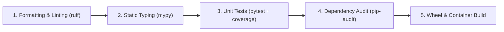

# CI/CD Pipelines, Build Engineering & GitOps Mastery — Interview Engineering Guide

This guide covers the 15 core continuous integration, artifact management, build debugging, and GitOps interview questions (Section 5 of the Cloud & DevOps curriculum). Answers are formulated from an enterprise SRE perspective, covering pipeline architecture, hermetic builds, dependency caching, SonarQube quality gates, and Argo CD reconciliation mechanics.

---

## Question Index

| # | Topic | Key SRE Focus |
| :--- | :--- | :--- |
| **5.1** | Jenkins Shared Libraries | Centralized Groovy pipelines, `vars/` vs `src/`, code reuse across microservices |
| **5.2** | Core Maven Build Lifecycle Targets | `clean`, `compile`, `test`, `package`, `verify`, `install` phases |
| **5.3** | Artifact Repository Architecture | JFrog Artifactory vs Sonatype Nexus, proxying remote repos, immutability |
| **5.4** | Configuring Artifactory in Maven | `settings.xml` mirrors, encrypted server credentials, `pom.xml` distribution management |
| **5.5** | Build Passes Locally but Fails in CI | Environmental drift, uncommitted files, runner runtime differences, locale/tz |
| **5.6** | CI Succeeds but Application Fails in Prod | Missing database migrations, unconfigured runtime secrets, unmocked upstream APIs |
| **5.7** | Pipeline Speed Optimization | Docker layer caching, dependency cache (`.m2`/`.npm`), shallow clones (`--depth 1`) |
| **5.8** | Feature Branch Push Fails to Trigger Pipeline | Webhook payload triage, branch filtering regex, GitHub event permissions |
| **5.9** | Build Fails Downloading Dependencies | Expired service account tokens, proxy/firewall SSL inspection, upstream 403s |
| **5.10** | Python Build Fails in CI but Works Locally | Missing OS-level C headers (`gcc`, `libpq-dev`), unpinned transitive dependencies |
| **5.11** | End-to-End Python CI Build Pipeline | Formatting (`ruff`), type checking (`mypy`), unit tests (`pytest`), wheel packaging |
| **5.12** | Static Code Analysis (SonarQube) | Quality gates, cyclomatic complexity, technical debt ratio, SAST security vulnerabilities |
| **5.13** | Optimizing Static Analysis in Pipelines | Differential PR branch analysis vs full scan, multi-threaded AST parsing |
| **5.14** | Argo CD `OutOfSync` Without Git Changes | Mutating admission webhooks, HPA replica drift, Kube-API default field injection |
| **5.15** | Automated Failure Notifications | Post-build failure hooks, webhook integration with Slack/PagerDuty, email triage |

---

### Question 5.1: What are Jenkins Shared Libraries, and why are they critical in enterprise engineering?

#### The Problem of Pipeline Duplication
In organizations managing dozens or hundreds of microservices, maintaining individual `Jenkinsfile` definitions inside each repository leads to catastrophic technical debt:
- Duplicate bash scripts copied across 50 repositories.
- Inconsistent security scanning stages.
- When a security tool changes (e.g. migrating from SonarQube v8 to v10 or updating Docker build arguments), engineers must manually edit and test 50 different Jenkinsfiles.

#### The Shared Library Solution
A Jenkins Shared Library is a centralized Git repository containing reusable Groovy code and pipeline steps. Individual microservices define a minimal, declarative 10-line `Jenkinsfile` that imports the shared library.

#### Directory Architecture
```
jenkins-shared-library/
├── vars/
│   ├── buildJavaService.groovy      # Global custom pipeline steps (accessible in Jenkinsfile)
│   ├── notifySlack.groovy           # Notification helper
│   └── runSecurityScan.groovy       # Standardized security scan
└── src/
    └── org/company/sre/
        └── DeploymentHelper.groovy  # Standard Object-Oriented Groovy classes
```

#### Consumer Repository `Jenkinsfile`:
```groovy
@Library('enterprise-pipeline-library@v2.1.0') _

buildJavaService {
    appName    = 'payment-service'
    targetPort = 8080
    enableTrivyScan = true
}
```

#### Key Enterprise Benefits
1. Versioned Governance: Pipelines can be pinned to Git tags (`@v2.1.0`), preventing breaking pipeline changes from impacting production teams.
2. Centralized Compliance: Security teams can mandate SAST, container scanning, and approval gates globally in one repository.

---

### Question 5.2: Explain the standard Maven build lifecycle phases used in enterprise CI pipelines.

Maven operates on an opinionated, ordered build lifecycle. Invoking a phase automatically executes all preceding phases in the sequence:

```
[ clean ] ---> [ validate ] ---> [ compile ] ---> [ test ] ---> [ package ] ---> [ verify ] ---> [ install ] ---> [ deploy ]
```

#### The 6 Core Day-to-Day Targets:

1. `mvn clean`:
   Deletes the `target/` directory containing artifacts from previous builds. Ensures the pipeline starts with a clean slate without stale bytecode.
2. `mvn compile`:
   Compiles the application source code (`src/main/java`) into `.class` bytecode files stored in `target/classes`.
3. `mvn test`:
   Executes unit tests using JUnit or TestNG from `src/test/java`. If any unit test assertions fail, the build halts immediately. Tests run against compiled classes without packaging a JAR.
4. `mvn package`:
   Takes the compiled code and test results and packages them into the distributable format defined in `pom.xml` (e.g., `.jar`, `.war`).
5. `mvn verify`:
   Executes integration test suites against the packaged artifact (e.g. running test containers or smoke tests) and validates quality metrics.
6. `mvn deploy`:
   Uploads the finished `.jar`/`.war` package along with its metadata to an enterprise artifact repository (JFrog Artifactory or Sonatype Nexus).

---

### Question 5.3: How do you evaluate and select an enterprise artifact repository?

#### Architectural Role of Artifact Repositories
Source code repositories (Git) store human-authored code; they are fundamentally unsuited for large binary artifacts (`.jar`, `.whl`, `.tar.gz`, Docker images).

Artifact repositories act as:
1. The Single Source of Truth for immutable release binaries.
2. A caching proxy (mirror) for external public registries (Maven Central, npmjs, PyPI, Docker Hub), safeguarding CI builds from upstream internet outages or rate limits.

#### Comparison: JFrog Artifactory vs Sonatype Nexus

| Feature | JFrog Artifactory | Sonatype Nexus |
| :--- | :--- | :--- |
| **Package Support** | Universal (30+ formats: Maven, npm, PyPI, Helm, Docker, Conan) | Comprehensive (Maven, npm, PyPI, Docker, NuGet) |
| **Security Scanning** | JFrog Xray (deep binary component analysis & CVE mapping) | Nexus Lifecycle (Sonatype OSS Index) |
| **High Availability** | Enterprise active-active clustering | Active-active available in Pro edition |
| **Cloud Storage Backend** | Native S3, Google Cloud Storage, Azure Blob | S3, Azure Blob, local block storage |

---

### Question 5.4: How do you configure Maven to authenticate and push to an enterprise Artifactory repository?

#### Separation of Concerns: `pom.xml` vs `settings.xml`
- `pom.xml` is checked into Git: Contains public repository URLs and project metadata. It must **never** contain passwords or API tokens.
- `settings.xml` resides securely on the CI runner (`~/.m2/settings.xml`): Contains secret credentials mapping to repository IDs.

#### Step 1: Define Server Credentials in `~/.m2/settings.xml`
```xml
<settings>
  <servers>
    <server>
      <id>artifactory-releases</id>
      <username>${env.ARTIFACTORY_USER}</username>
      <password>${env.ARTIFACTORY_API_KEY}</password>
    </server>
  </servers>
</settings>
```

#### Step 2: Define Distribution Management in Project `pom.xml`
```xml
<project>
  <distributionManagement>
    <repository>
      <!-- ID MUST exactly match the server ID in settings.xml -->
      <id>artifactory-releases</id>
      <name>Internal Enterprise Releases</name>
      <url>https://artifactory.company.internal/artifactory/libs-release-local</url>
    </repository>
  </distributionManagement>
</project>
```

---

### Question 5.5: A build passes reliably on a developer's local workstation but fails in the CI pipeline. How do you triage this?

#### The "Works on My Machine" Root Cause Taxonomy

1. Environmental Drift (Runtimes & SDKs):
   - Developer has Java 21 or Node 20.10 installed locally; the CI agent image runs Java 17 or Node 18.0.
   - *Fix:* Enforce containerized builds where both local developers and CI runners execute inside the identical Docker image (`mvn:3.9-eclipse-temurin-17`).

2. Uncommitted Files (.gitignore / Git Dirty State):
   - Developer created a new configuration file, class, or dependency locally but forgot to `git add` it. It compiles on their workstation because the file exists on disk, but fails in CI on a clean checkout.
   - *Fix:* Run `git status` locally; CI runs start from a detached, clean `HEAD`.

3. Case Sensitivity in Filesystems:
   - Developer works on macOS (APFS) or Windows (NTFS), both of which are case-insensitive by default (`import "./Header"` finds `./header.js`).
   - The CI runner runs Linux (ext4), which is strictly case-sensitive. The build fails with `File Not Found`.

4. Local Cache Poisoning:
   - Developer's local `~/.m2/repository` or `node_modules` contains a locally modified library snapshot or cached transitive dependency that no longer exists in remote registries.

5. Timezone & Locale Assumptions:
   - Unit tests parsing timestamps or strings make assumptions about local timezone (`IST` or `PST`) instead of `UTC`.

---

### Question 5.6: The CI/CD pipeline succeeded with 100% test pass rate, but the application is completely broken in Production. What happened?

#### The Production Divergence Gap

1. Missing Database Migrations:
   - CI tests run against an in-memory database (H2 or SQLite) or apply migrations automatically in an isolated test container.
   - The production deployment pipeline deployed the new binary, but database schema migration scripts (`Flyway` / `Liquibase`) were not executed against the live RDS database, causing the application to crash on boot due to missing columns.

2. Secret and Environment Variable Misalignment:
   - New code references a required environment variable (e.g. `STRIPE_WEBHOOK_SECRET` or `REDIS_CLUSTER_URL`).
   - The variable was present in test environments but never seeded into AWS Secrets Manager or Kubernetes Secrets in the production namespace.

3. External Third-Party API Breaking Changes:
   - Unit and integration tests in CI used mock servers (`WireMock`) that returned successful responses.
   - In production, the actual third-party partner API changed payload format, returned rate-limit errors, or required TLS mutual authentication.

4. Network & Egress Routing:
   - Production instances reside in private subnets with strict security group egress rules. The application tried to connect to an external webhook service, but traffic was blocked because egress port 443 was not permitted in the production network policy.

---

### Question 5.7: CI pipelines slow down significantly over time. How do you profile and optimize pipeline execution?

#### Optimization Strategies (Ordered by Impact)

1. Caching Package Dependencies Across Builds:
   Downloading gigabytes of dependencies (`~/.m2`, `~/.npm`, `~/.cache/pip`) on every run is the single largest source of pipeline latency.
   ```yaml
   # GitHub Actions Cache Example
   - name: Cache Maven Dependencies
     uses: actions/cache@v4
     with:
       path: ~/.m2/repository
       key: ${{ runner.os }}-maven-${{ hashFiles('**/pom.xml') }}
       restore-keys: |
         ${{ runner.os }}-maven-
   ```

2. Docker Layer Caching (BuildKit):
   Order Dockerfile instructions so dependencies are copied and cached before application source code. Export cache to remote registries (`--cache-to=type=registry`).

3. Shallow Git Clones:
   By default, CI systems may clone full repository histories (hundreds of megabytes). Restrict checkout depth:
   ```yaml
   - uses: actions/checkout@v4
     with:
       fetch-depth: 1
   ```

4. Parallel Test Execution (Matrix Builds):
   Split test suites into independent shards executing concurrently across multiple runners:
   ```yaml
   strategy:
     matrix:
       shard: [1, 2, 3, 4]
   run: pytest --shard-id=${{ matrix.shard }} --num-shards=4
   ```

5. Ephemeral, Auto-scaling Runners:
   Replace static, queued Jenkins workers with Kubernetes-based ephemeral runners (e.g., GitHub Actions Runner Controller - ARC) that scale on demand.

---

### Question 5.8: A developer pushes to a feature branch, but the CI pipeline does not trigger. How do you triage this?

#### Triage Checklist

1. Inspect Webhook Delivery Logs on Git Provider:
   - Navigate to GitHub / GitLab -> Repository Settings -> Webhooks -> Deliveries.
   - Did GitHub attempt to send the webhook?
   - If HTTP response is `403 Forbidden` or `401 Unauthorized`: Webhook HMAC secret token is misconfigured or expired.
   - If HTTP response is `Connection Timed Out`: The CI controller's ingress firewall or security group is blocking GitHub's IP range.

2. Branch Filtering Regex:
   - Inspect the pipeline configuration file. Many pipelines are explicitly configured to run only on specific branches:
     ```yaml
     on:
       push:
         branches: [ main, master, release/* ] # Feature branches (feature/*) intentionally excluded
     ```

3. Git Push Event vs Pull Request Event:
   - Some pipelines are configured to trigger on `pull_request` creation, not raw branch pushes. If no PR is open, the push produces no build.

4. Path Filtering (`paths` / `paths-ignore`):
   - If the developer only modified files in `docs/` or `README.md`, and the pipeline has `paths-ignore: ['**.md']`, GitHub Actions skips the workflow by design.

---

### Question 5.9: A build fails with a 401 or 403 error while downloading dependencies from an artifact repository. What is the root cause?

#### Common Failure Modes
1. Expired Service Account Token: CI runners authenticate to Artifactory/Nexus via API tokens or temporary OAuth tokens with expiration lifecycles.
2. Network Proxy / SSL Interception: Corporate firewalls performing TLS deep-packet inspection break Java's trusted keystore (`cacerts`), causing SSL handshake failures during dependency retrieval.
3. IP Allowlisting / Private VPC: The CI runner is executing on a public cloud runner that cannot route to an internal artifact repository behind a corporate VPN/DirectConnect.
4. Repository Permissions: The service account token belongs to a read-only role that lacks access to a newly added private repository path.

---

### Question 5.10: A Python build succeeds locally on macOS/Windows but fails on the Linux CI runner with compilation errors. Why?

#### The C-Extension & Wheel Trap
Many popular Python libraries (`numpy`, `psycopg2`, `cryptography`, `grpcio`) are not pure Python; they contain compiled C/C++ extensions:
- On a developer's workstation, `pip install` downloads a pre-compiled binary wheel (`.whl`) matched to macOS or Windows architecture.
- When the Linux CI container executes `pip install`, if no pre-compiled `manylinux` wheel exists for that specific Python version, `pip` falls back to compiling the source distribution (`.tar.gz`).
- The minimal Linux CI runner lacks the necessary compiler and header files, failing with:
  ```
  error: command 'gcc' failed: No such file or directory
  fatal error: Python.h: No such file or directory
  ```

#### Solution:
1. Install OS build dependencies in the CI runner image:
   ```bash
   apt-get install -y gcc build-essential python3-dev libpq-dev
   ```
2. Or use binary-only distribution packages where available:
   ```bash
   pip install psycopg2-binary
   ```
3. Use strict dependency locking via `poetry.lock` or `pip-compile` to ensure deterministic versioning.

---

### Question 5.11: Outline the standard phases of an enterprise Python CI pipeline.

A production-grade Python CI pipeline must enforce code hygiene, typing guarantees, test coverage, and artifact generation in this exact order:



1. Code Formatting & Linting:
   - Tool: `ruff` (extremely fast Rust-based linter replacing `flake8`, `black`, and `isort`).
   - Checks syntax standards, unused imports, and style consistency.
2. Static Type Verification:
   - Tool: `mypy --strict`.
   - Ensures type annotations are respected, preventing runtime `TypeError` exceptions.
3. Unit & Integration Testing:
   - Tool: `pytest -v --cov=src --cov-fail-under=80`.
   - Runs unit tests and enforces an 80% minimum branch code coverage threshold.
4. Dependency Security Audit:
   - Tool: `pip-audit` or `safety`.
   - Scans installed packages against known CVE vulnerability databases.
5. Packaging & Image Build:
   - Tool: `build` (generates standard `.whl`) and `docker build` (multi-stage build producing hardened minimal container).

---

### Question 5.12: What problems does Static Code Analysis (e.g., SonarQube) detect, and what is a "Quality Gate"?

#### Defects Identified by Static Analysis:
1. Bugs & Logic Errors: Null-pointer dereferences, resource leaks (unclosed database connections or file handles), infinite recursion risk.
2. Security Vulnerabilities (SAST): SQL injection vectors, hardcoded secrets/API keys, insecure cryptographic algorithms (MD5/SHA1), cross-site scripting (XSS).
3. Code Smells & Maintainability: Duplicate code blocks, excessive cyclomatic complexity (deeply nested `if/else` logic), unused parameters, dead code.
4. Test Coverage Deficits: Highlights lines of business logic that lack corresponding unit tests.

#### What is a Quality Gate?
A **Quality Gate** is an automated pass/fail condition enforced in the CI pipeline based on predefined threshold criteria.

If the new code violates the Quality Gate, the pipeline stops immediately and blocks the Pull Request from merging.

#### Standard Enterprise Quality Gate Policy:
- 0 New Critical or High Security Vulnerabilities.
- 0 New Bugs.
- Less than 3% Duplicated Code on New Code.
- Minimum 80% Unit Test Coverage on New Code.
- Security Rating of `A`.

---

### Question 5.13: Static code analysis significantly slows down CI execution. How do you optimize it?

#### Optimization Strategies
1. Analyze Only Changed Code (PR Differential Analysis):
   Instead of analyzing the entire 500,000-line monolithic codebase on every commit, configure SonarQube for **Pull Request Analysis**. SonarQube inspects only the modified git diff, reducing analysis time from 15 minutes to under 30 seconds.
2. Run Analysis Asynchronously or in Parallel:
   Execute static code analysis concurrently alongside unit tests rather than sequentially.
3. Cache the Scanner Working Directory:
   Cache the `.sonar/cache` directory across pipeline executions to avoid re-parsing unchanged AST (Abstract Syntax Tree) files.
4. Exclude Auto-Generated Code:
   Explicitly exclude Protobuf generated files, database migration files, and third-party UI bundles in `sonar.exclusions`.

---

### Question 5.14: In Argo CD, an application enters an `OutOfSync` state even though no changes were committed to Git. Why?

#### The GitOps Drift Reality
Argo CD continuously performs a 3-way diff between:
1. Target State: The manifests in the Git repository.
2. Live State: The actual resources running in the live Kubernetes cluster.
3. Last Applied Configuration: The state recorded in the `kubectl.kubernetes.io/last-applied-configuration` annotation.

An application becomes `OutOfSync` when the **Live State** changes without Git changing.

#### Common Causes & SRE Fixes

1. Mutating Admission Webhooks:
   - An in-cluster admission controller (e.g. Istio sidecar injector, Datadog injector, Vault agent) modifies the live Pod spec by adding annotations, sidecar containers, or volume mounts.
   - *Fix:* Configure Argo CD `ignoreDifferences` in the `Application` spec to ignore mutating webhook annotations.

2. Horizontal Pod Autoscaler (HPA):
   - The Git manifest states `replicas: 2`.
   - The live HPA scaled the deployment up to `replicas: 8` due to CPU utilization.
   - Argo CD detects a mismatch between Git (2) and Live (8).
   - *Fix:* Remove the explicit `replicas` field from the Git Deployment manifest, letting HPA control scale exclusively, or configure `ignoreDifferences` on `/spec/replicas`.

3. Kubernetes API Server Defaulting:
   - When you apply a manifest, the Kubernetes API server injects default values that were not in your YAML (e.g. `protocol: TCP` on Ports or `imagePullPolicy: IfNotPresent`).
   - If using Kustomize or Helm incorrectly, Argo CD may flag these injected defaults as drift.

---

### Question 5.15: How do you configure reliable failure notifications in CI/CD without spamming engineering teams?

#### Notification Principles
- **Never Alert on Every Build:** Sending notifications on every successful build creates alert fatigue; engineers quickly filter them to a muted folder.
- **Alert on State Transitions:** Only alert when a pipeline **transitions from Success to Failure** (broken build) or **transitions from Failure to Success** (build fixed).
- **Direct Notification to the Committer:** Send the initial failure notification directly to the specific committer who broke the build, with team channels notified only if the build remains broken on the main trunk.

#### Implementation in Modern CI:
- **Jenkins:** Use the `post` block:
  ```groovy
  post {
      failure {
          slackSend channel: '#alerts-ci', color: '#FF0000', message: "Job ${env.JOB_NAME} failed on commit ${env.GIT_COMMIT}"
      }
      fixed {
          slackSend channel: '#alerts-ci', color: '#00FF00', message: "Job ${env.JOB_NAME} is back to healthy."
      }
  }
  ```
- **GitHub Actions:** Use GitHub Actions status checks with conditional steps:
  ```yaml
  - name: Notify Slack on Failure
    if: failure() && github.ref == 'refs/heads/main'
    uses: slackapi/slack-github-action@v1.26.0
    with:
      payload: |
        {
          "text": "Pipeline failed on main: ${{ github.server_url }}/${{ github.repository }}/actions/runs/${{ github.run_id }}"
        }
  ```
